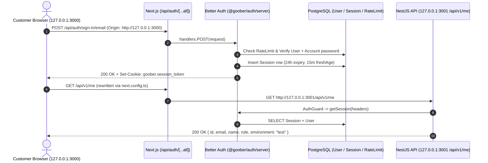
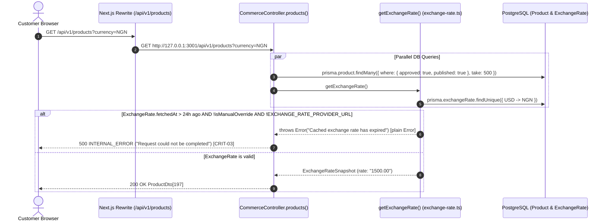
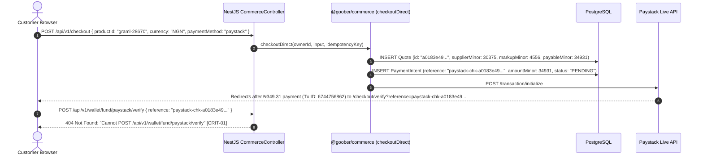
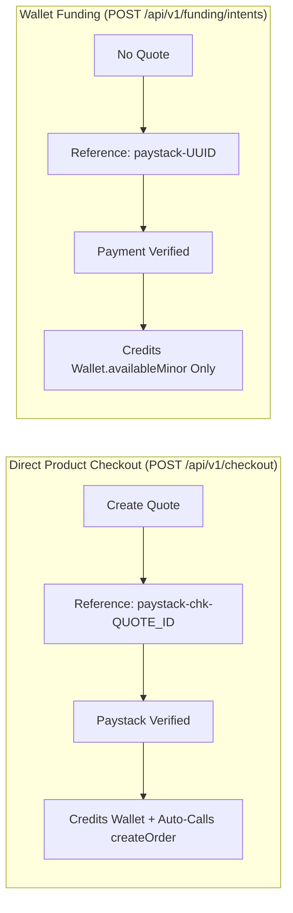
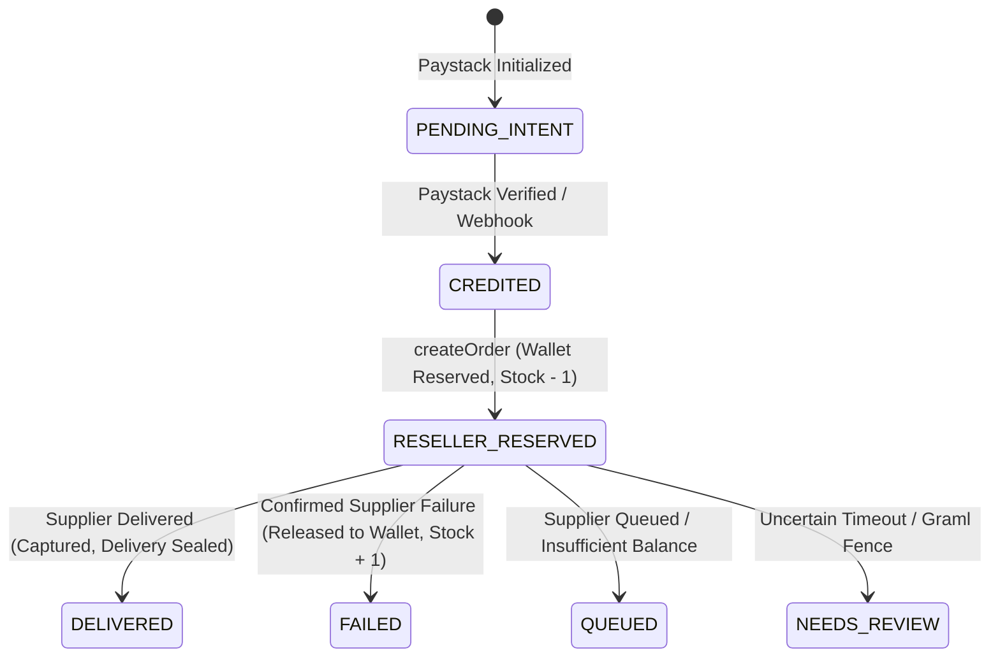
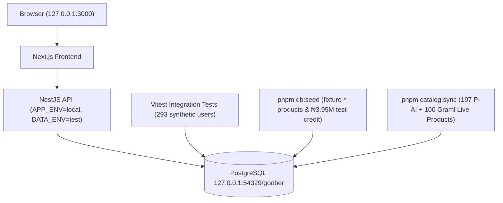

# GOOBER — Independent Technical Architecture Handoff

## 1. Purpose of This Document
This handoff summarizes the forensic investigation of GOOBER at commit `64080ec` (`branch: codex/goober-m3-auth-recovery-landing-redesign`) for review by the owner and an independent technical advisor prior to remediation.

---

## 2. Companion Investigation Documents (`docs/`)
1. [`docs/GOOBER_CURRENT_ARCHITECTURE.md`](./GOOBER_CURRENT_ARCHITECTURE.md) — Monorepo structure, Next.js/NestJS/BullMQ/Prisma architecture, and PostgreSQL triggers.
2. [`docs/GOOBER_PAYMENT_AND_FULFILLMENT_TRACE.md`](./GOOBER_PAYMENT_AND_FULFILLMENT_TRACE.md) — End-to-end trace of the failed `₦349.31` Paystack purchase (`id: 6744756862`), the missing `/api/v1/wallet/fund/paystack/verify` route, Graml/P-AI balance verification, and cross-currency ledger findings.
3. [`docs/GOOBER_ENVIRONMENT_AND_DATA_AUDIT.md`](./GOOBER_ENVIRONMENT_AND_DATA_AUDIT.md) — Environment configuration, table-by-table contamination counts in `127.0.0.1:54329/goober`, and safe cleanup strategy.
4. [`docs/GOOBER_APPLICATION_FEATURE_INVENTORY.md`](./GOOBER_APPLICATION_FEATURE_INVENTORY.md) — Complete status matrix of all customer, admin, and worker features.
5. [`docs/GOOBER_RUNTIME_AND_AUTH_DIAGNOSTIC.md`](./GOOBER_RUNTIME_AND_AUTH_DIAGNOSTIC.md) — Root causes of the `GET /api/v1/products` `HTTP 500` outage (24h `ExchangeRate` expiry) and `pnpm dev` startup/login failures.
6. [`docs/GOOBER_PRODUCTION_READINESS_AND_REMEDIATION.md`](./GOOBER_PRODUCTION_READINESS_AND_REMEDIATION.md) — Prioritized defect register (`CRIT-01`–`CRIT-05`, `HIGH-01`–`HIGH-03`) and 4-step remediation plan.

---

## 3. Key Forensic Conclusions

### 3.1 What Happened to the Owner's Paystack Payment?
- **Transaction**: `paystack-chk-a0183e49-a4f2-4031-bee0-274db23ad2cc` (`PaymentIntent` `268e5c60-d4b9-4821-8658-25a578e5eb09`, Quote `a0183e49-a4f2-4031-bee0-274db23ad2cc` for Graml product `graml-28670`).
- **Amount**: `34931` kobo (`₦349.31` NGN = `₦303.75` Graml base cost + `₦45.56` [15%] markup).
- **Paystack Status**: **Approved & Paid** (`id: 6744756862`, `status: "success"`, `channel: "bank_transfer"`, `paid_at: "2026-11-09T01:43:52.000Z"`, `domain: "live"`).
- **Why It Failed on Return**: `apps/web/app/checkout/verify/page.tsx:23` sent `POST /api/v1/wallet/fund/paystack/verify`, whereas `apps/api/src/commerce.controller.ts:32` only registered `@Post('payments/paystack/verify')`. Express returned `404 Cannot POST /api/v1/wallet/fund/paystack/verify`.
- **Current State**: The `₦349.31` is safely in the owner's Paystack merchant account; `PaymentIntent` `268e5c60-d4b9-4821-8658-25a578e5eb09` is still `PENDING` in PostgreSQL; no `Order` was created, and Graml Social was never called.

### 3.2 What Is the State of the Supplier Accounts?
- **Graml Social (`RaymondX`)**: Verified via `GET https://gramlsocial.com/api/v1/my/balance` — **`₦572.00` NGN available** (`status: "success"`). Sufficient to fulfill `graml-28670` (`₦303.75`) once `CRIT-01` and `HIGH-01` are fixed.
- **P-AI (`Goober Tools`)**: Verified via `GET https://p-ai.world/api/v1/me` — **`$0.00` USD available** (`mode: "live"`). Also requires fixing `/api/v1/orders` $\rightarrow$ `/api/v1/order` in `apps/worker/src/processor.ts:63`.

### 3.3 Why Did the Catalogue & `pnpm dev` Fail Today?
1. **Catalogue `HTTP 500` (`CRIT-03`)**: `ExchangeRate.fetchedAt` (`2026-11-09T01:20:20.667Z`) passed the 24-hour TTL (`DEFAULT_MAX_AGE_MS`) without `EXCHANGE_RATE_PROVIDER_URL`, causing `getExchangeRate()` (`packages/commerce/src/exchange-rate.ts:163`) to throw an unhandled `Error` on every `/api/v1/products` request.
2. **`pnpm dev` Port Collision (`HIGH-03`)**: Detached background `node.exe` processes (`PID 26908` on `:3000`, `PID 17796` on `:3001`, `PID 3168` worker) were already holding ports `3000` and `3001`, causing `concurrently -k` to abort immediately with `EADDRINUSE`.


---

## 4. Complete Application Execution Flow Diagrams

### Flow A: Customer Authentication


### Flow B: Product Catalogue & 24-Hour Expiry Outage (`CRIT-03`)


### Flow C: Product Checkout & The Missing Verify Route (`CRIT-01`)


### Flow D: Supplier Fulfillment (`HIGH-01` & `CRIT-05`)
```mermaid
sequenceDiagram
    autonumber
    participant Trigger as fulfillOrderInline / Worker
    participant Proc as processor.ts (fulfill)
    participant DB as PostgreSQL
    participant Live as tryLiveSupplierPurchase (Graml / P-AI)
    participant Fix as FixtureSupplier

    Trigger->>Proc: processOutbox(outboxId) -> fulfill(orderId)
    Proc->>DB: SERIALIZABLE tx: create/increment ProviderAttempt fence
    Proc->>Live: tryLiveSupplierPurchase(provider, request)
    Note over Live,Fix: HIGH-01: P-AI calls /orders instead of /order; errors caught and fall back to FixtureSupplier!
    Proc->>DB: completeOrder(orderId, outcome) [CRIT-05: compares supplierMinor against reservedMinor across currencies]
```

### Flow E: Wallet Funding vs. Direct Product Checkout


### Flow F: Failure Recovery State Machine


### Flow G: Production vs. Test Data Contamination Map

