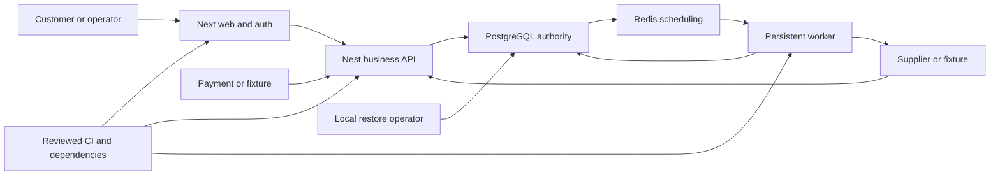

# GOOBER M1 threat model

## Executive summary

The highest risks are unauthorized spending, duplicate economic effects after retries, cross-customer credential disclosure, and a supplier request repeated after an unknown outcome. M1 is a local fixture system with real PostgreSQL/Redis, not a live supplier/payment deployment. Source review covers the integrated API, commerce package, adapters and persistent worker. Two focused synthetic PostgreSQL probes reproduced a plaintext supplier-reason leak and reversal-before-credit ordering gap; both fixes subsequently passed 17 independent PostgreSQL/Redis regressions plus signed HTTP callback follow-ups on a fresh isolated database. Real-browser QA also exposed pre-hydration credential-form GET fallback; explicit POST and disabled server-rendered controls are now independently verified, with full browser regression closure tracked in the security report. See `docs/security-review.md` for commands, current findings and limits. Other controls described as required remain review targets unless actual evidence is named.

## Scope and assumptions

- Evidence: `AGENTS.md`; adopted `docs/source/GOOBER-plan-and-Codex-brief.md` A3-A8, B6-B7 and C1-C5; `docs/DECISIONS.md`; implementation anchors in the table below. Brief section references identify requirements and must not be substituted for passing tests.
- Runtime scope: Next.js storefront/auth handler, shared Better Auth configuration, NestJS business API, PostgreSQL, Redis/BullMQ, persistent worker, supplier/payment adapters, delivery reveal and operations/support workflows.
- Intended context: Raymond owns the service; isolated synthetic local users/funds now, future same-origin public store later. Sessions are opaque and database-backed. Customers own their wallet/orders/support records; operations access requires current database roles.
- Supplier USD/NGN assets and customer NGN liabilities are separate. No customer passwords/2FA inputs, withdrawals, seller payouts, arbitrary uploads or automatic supplier topups in M1.
- User has supplied scope and explicitly authorized engineering/security fixes; no extra assumption-confirmation pause is required. Owner assurance is already recorded in the decision log and is not independently verified by this review.
- Out of scope: public deployment, paid purchases, real customer money, production host hardening and independently verifying resale permissions. Specific product approval records remain required.
- Open release questions: actual edge/proxy topology, administrative MFA/step-up, real reset/verification email delivery, approved price exposure, key backup/access policy, and externally verified supplier recovery contracts. These do not block local implementation; they materially affect future public risk.

## System model

### Primary components

The required TypeScript/pnpm architecture is Next.js plus NestJS, Prisma/PostgreSQL, Better Auth and BullMQ/Redis with a persistent worker (`AGENTS.md`; brief A3). PostgreSQL owns ledger, quotes, orders, attempts and durable inbox/outbox; Redis may be lost without losing authority (brief C2). Only server adapters hold supplier keys and issue outbound requests (brief B6). Sensitive receipt/delivery material is encrypted and exposed through a dedicated reveal route (brief C3).

### Data flows and trust boundaries

- **B1 Browser → Next.js/auth → NestJS**, same-origin HTTP locally and HTTPS for deployed use: credentials, opaque session cookie and commerce inputs. Required: trusted canonical origins, HttpOnly/SameSite cookie settings appropriate to local HTTP, runtime input bounds, cookie-write CSRF protection, and current session/role/ownership checks. Forwarded identity/host headers are untrusted unless infrastructure explicitly replaces them. Evidence: brief A3/C3.
- **B2 API/worker → PostgreSQL**, parameterized SQL/Prisma over local TCP: users, journals, financial locks, encrypted receipts and durable work. Required: restricted runtime role, immutable balanced per-currency postings, serializable financial writes with bounded retries and no HTTP inside transactions. Evidence: brief A4/C2/B7.17.
- **B3 PostgreSQL/outbox → Redis/BullMQ → worker**, local service TCP: identifiers and non-secret job metadata. Required: PostgreSQL authority, idempotent consumers, leases, recoverable redelivery, no delivery secrets in jobs. Evidence: brief C2/B7.9.
- **B4 Worker → supplier/payment**, allowlisted HTTPS: provider reference, bounded typed purchase input and server-only key. Required: finite time/body limits, no credential-forwarding redirects, explicit environment/mode checks and separate provider recovery policies. Graml fence commits before a single fixture purchase; P-AI lookup uses the original reference. Evidence: brief B6/C2/C4.
- **B5 External callback → NestJS inbox → worker**, HTTP callback with untrusted raw bytes/headers: payment or supplier status, potentially secret delivery payload. Required: bounded exact raw-body HMAC verification, signed payload/header identity validation, environment/account/reference binding, encrypted sensitive body storage, durable inbox commit before 2xx and deduplicated economic application. Evidence: brief A3/B6/C3.
- **B6 Operator → operations/bootstrap/restore**, local CLI or role-protected HTTP: approvals, review resolutions, configuration and backup files. Required: audited reasons/version/operation IDs, protected key material, restore to isolation, dispatch paused pending reconciliation. Evidence: brief C3-C4/B7.20.
- **B7 Developer/CI → build artifacts/runtime**, package registry/repository/files: dependencies, migrations and bundles. Required: reviewed pinned dependency scripts, frozen lockfile, minimum CI token permissions, isolated fixtures, no live keys or browser-exposed server secrets. Evidence: brief C5; `AGENTS.md`.

#### Diagram

## Assets and security objectives

| Asset | Why it matters | Security objective |
| --- | --- | --- |
| Customer available/reserved NGN and supplier assets | Unauthorized credit, overspend or mixed-currency postings creates loss | I/A |
| Quotes, operation uniqueness, orders and dispatch fences | Retries must not create another purchase or erase uncertainty | I/A |
| Opaque sessions, passwords and current roles | Establish identity and privileged authority | C/I |
| Delivery codes/account lines and sensitive receipts | Disclosure transfers customer entitlement to an attacker | C/I |
| Provider/payment keys, fixture signers and encryption keys | Forgery, external spending and bulk disclosure | C/I |
| Inbox/outbox, audit and reversal obligations | Recover economic state and investigate disputes | I/A |
| Approved entitlement snapshots and mode records | Prevent substituted products and test funds reaching live systems | I |
| Backups, keys and build artifacts | Preserve confidentiality and prevent replay after restore | C/I/A |

## Attacker model

### Capabilities

For the future public store, an unauthenticated remote client can register, send malformed/oversized requests, spoof headers and attempt forged/replayed callbacks. An ordinary customer can race requests, vary quote/idempotency bodies, submit hostile support text and guess other object identifiers. A hostile/compromised supplier can return malicious strings/URLs or contradictory status. A stolen customer/admin session inherits that user's actual authority until expiry/revocation. Job duplication, process loss, network ambiguity, Redis loss and database restoration are failure adversaries even without a malicious actor.

### Non-capabilities

Remote clients are not assumed to read server files, decrypt authenticated ciphertext, forge HMAC without the corresponding secret, or administer PostgreSQL/CI. A fully compromised app host with encryption-key access can read deliveries; encryption at rest does not solve that case. Local M1 services must bind loopback unless explicitly needed otherwise; internet likelihood rankings below describe the intended public runtime and are lower for an isolated local fixture.

## Entry points and attack surfaces

| Surface | How reached | Boundary | Notes | Evidence |
| --- | --- | --- | --- | --- |
| Auth registration/sign-in/out/session | `/api/auth/*` | B1 | Public registration cannot grant roles; expiry/revocation must reach commerce | Brief A3/C3 |
| Catalog, wallet, quote and checkout | `/api/v1/*` | B1/B2 | Stable retail IDs; exact money strings; body/idempotency ownership | Brief C3 |
| Orders/delivery/support | Owned API records | B1/B2 | Fresh reveal session, no-store, audit, bounded plain text | Brief C3/B7.11/16/19 |
| Payment/supplier callback | Webhook route | B5/B2 | Raw bytes, malformed signatures, duplicate and late events | Brief B6/C3 |
| Supplier HTTP parser | Worker adapter calls | B4 | Malformed response, opaque credentials, redirect and timeout | Brief B6 |
| Queue/outbox/dead letter | Durable worker loop | B3/B4 | Duplicate execution and lease expiry are expected | Brief C2 |
| Admin review/approval/switch | Operations API/local bootstrap | B1/B6 | Current role, reason/version/operation ID; no arbitrary balance editor | Brief C3-C4 |
| Migration/runtime SQL/backup | Local infrastructure scripts | B2/B6/B7 | Runtime cannot disable triggers or remove posted history | Brief A4/B7.17/20 |
| Dependencies/build/CI | Developer-approved install and CI | B7 | Secret-free artifacts and isolated integration services | Brief C5 |

## Top abuse paths

1. Customer obtains another order ID → calls detail/reveal/support routes → missing owner predicate returns account credentials or permits a fraudulent complaint.
2. Attacker registers or spoofs a role/header → calls operations/refund → unchecked current role grants catalog control or money.
3. Customer concurrently accepts one quote with different keys or races two orders → wallet checks outside a lock/transaction pass → duplicate purchase or negative available balance.
4. Attacker signs with a fixture key against a live route, replays a payment under a new delivery ID, or changes amount/currency/reference → weak binding credits spendable value without a verified intent.
5. Worker times out after Graml accepts → retry/redelivery/restore re-enters dispatch → second paid purchase while the first outcome remains unknown.
6. Supplier delivers then local commit fails, or callbacks arrive delivered/queued/failed out of order → weak state transitions overwrite history, release funds prematurely or capture/refund twice.
7. Hostile receipt/support text is logged/rendered as HTML, or delivery ciphertext is copied to another order → leaked credentials or cross-order reveal without authenticated context.
8. Database snapshot predates a dispatch fence → restarted worker resumes pending outbox → duplicate external effects; missing key backup also makes legitimate deliveries unrecoverable.
9. Abusive client sends large bodies and unlimited quote/reveal/support requests → parser/queue/database exhaustion prevents order recovery.
10. Dependency script or CI change reads secrets → compromised artifact or leaked keys grants downstream supplier access.

Native form fallback is part of abuse path 7: JavaScript is delayed/disabled → an unguarded credential/support form defaults to GET → private fields enter history/access logs before API defenses apply. API-only tests cannot cover this browser boundary.

## Threat model table

Priority describes potential risk; it does not assert that every threat is an exploitable vulnerability. Findings require separate source and runtime evidence in `docs/security-review.md`.

| Threat ID | Threat source | Prerequisites | Threat action | Impact | Impacted assets | Existing controls (evidence) | Gaps | Recommended mitigations | Detection ideas | Likelihood | Impact severity | Priority |
| --- | --- | --- | --- | --- | --- | --- | --- | --- | --- | --- | --- | --- |
| TM-001 | Customer/session thief | Valid ordinary session or guessed ID | Bypass ownership/current role; reuse revoked session | Credential theft or privileged action | Sessions, delivery, money | Owner/current-role requirements, C3 | Local session/ownership tests passed (VERIFICATION A) | Central Nest guard plus resource owner predicates; disable stale session caching; role/bootstrap allowlist; fresh reveal session | Audit rejected privileged/reveal access without secret IDs in public logs | High: every user can exercise IDs | High: cross-customer secret/spend access | high |
| TM-002 | Cross-site attacker | Victim signed in | CSRF or spoof Host/forwarded identity | Unwanted purchase/reveal/privileged write | Sessions, orders | Same-origin/CSRF requirements, C3 | Local CSRF/Host proof passed (A) | Normalize exact trusted Origin; reject missing/foreign origin on cookie writes; custom JSON header/token; canonical host and narrow forwarding | Origin rejection counters; host mismatch events | Medium: requires victim session | High: authenticated effects | high |
| TM-003 | Racing customer/operator | Funded wallet or refundable order | Reuse quote, vary keys, race capture/release/refunds or alter SQL history | Double spend/overrefund/unreconciled funds | Ledger, quote/order uniqueness | A4/C2; DB invariant workflow | Real PostgreSQL proof passed (A) | Serializable lock order; unique quote/economic keys; deferred balance/immutability triggers; aggregate limits under same order lock; restricted runtime role | Journal reconciliation and conflict/retry metrics | High: concurrency is routine | High: financial integrity loss | high |
| TM-004 | Forged/replayed callback | Public callback ingress | Bypass HMAC, environment/intent binding or durability | Synthetic/unbacked credit; lost outcome | Inbox, balances, delivery | B6/C3 raw HMAC/durable inbox | Raw proxy/HMAC/race proof passed (A) | Exact bounded signature decoding then timing-safe compare; schema/identity validation; dedupe by signed economic identity; encrypted inbox; commit before 2xx | Signature rejection, callback lag and duplicate mismatch counters | High: ingress is public | High: unbacked money or secret exposure | high |
| TM-005 | Retry/crash/network adversary | Unknown supplier outcome | Repeat Graml POST or change P-AI reference/body | Duplicate supplier spend | Attempts, vendor assets | C2 durable fence/stable reference | Local crash/fence tests passed; external retention unverified | Unique persisted attempt/fence before HTTP; unknown retains hold; Graml review only; P-AI lookup before verified-safe replay | Unknown age, dispatch counts, fenced-redelivery audit | High: routine transport failures | High: irreversible duplicate spend | high |
| TM-006 | Late/hostile supplier event | Existing order and asynchronous events | Regress final outcome or process economic outcome twice | Premature release, lost delivery, double refund | Orders, ledger, receipts | C2 independent state axes | Local transition/replay proof passed (A) | Atomic normalized outcome/encrypted delivery/journal; final history monotonic; contradictions open review; durable event idempotency | Contradiction/review age and economic-op uniqueness counters | High: events duplicate/reorder | High: economic corruption | high |
| TM-007 | Customer/hostile supplier | Untrusted text or ciphertext access | Leak secret via summary/error/log/cache, inject script, swap ciphertext | Entitlement or key theft | Delivery, receipts, keys | C3/B7.19 secret protections | Local asset/log/AEAD and SEC005 browser proof passed (A) | AES-GCM with unique nonce, key ID and order/provider/environment AAD; DTO allowlists; no-store reveal; plain text JSX; no arbitrary URL fetch; bounded secret-free support | Synthetic secret canary scans and audited reveal counts | Medium: requires bad sink or record access | High: disclosure cannot be recalled | high |
| TM-008 | Operator mistake/config attacker | Mode mismatch or restored snapshot | Use test funds externally, resume lost fences | Unbacked spend or duplicate purchase | Mode/dispatch/financial state | C4 explicit modes/restore pause | Local mode matrix and isolated restore passed (A) | Validate startup and adapter boundaries; persistent data modes; fixture signer only isolated fixtures; read-only Graml GET allowlist; restored dispatch paused until receipts reconcile | Mode mismatch rejection, restore marker, dispatch switch audit | Medium: misconfiguration is plausible | High: external financial effects | high |
| TM-009 | Abusive remote client/vendor | Reachable request/parser | Exhaust parser, DB, auth or recovery budget | Recovery delay and denial of service | Availability, outbox | C1 bounded requests/worker two | Bounded parsing, auth429 and recovery-budget tests passed; production metrics unrun | Finite body/time/page bounds; per-user auth/reveal/support limits; conservative supplier budget with recovery reserve; bounded retries and inspectable dead letters | Queue delay, callback lag, throttles, DB pressure | Medium: cheap requests | Medium: temporary outage | medium |
| TM-010 | Malicious dependency/CI actor | Install/build pipeline access | Exfiltrate secrets or change trusted artifacts | Systemic supply-chain compromise | Keys, artifacts, all records | G0/C5 provenance/frozen lockfile | Pinned install review, frozen policy and advisory audits passed; remote CI unrun | Pin and review scripts; least CI permissions; isolate PR secrets; no live keys in CI; verify no server secrets in client assets | Lockfile/script diff review and secret scan | Low: requires supply-chain access | High: host/build authority | high |

## Criticality calibration

- **Critical:** demonstrated unauthenticated arbitrary financial credit/control; app/server code execution exposing all delivery keys; bulk cross-customer delivery disclosure. No critical finding was demonstrated in the reviewed local implementation.
- **High:** repeatable wallet overspend/overrefund; stale-session admin authority; Graml redispatch after uncertainty; owner-check bypass on one customer's delivery. These block M1 completion when demonstrated.
- **Medium:** bounded targeted worker/parser exhaustion; incomplete rate limiting with measurable recovery impact; unsafe public error detail without secrets. Fix within scope or explicitly record residual limits.
- **Low:** version/fingerprint disclosure alone; cosmetic audit copy confusion without authority effects; a hardening header absent only on isolated local HTTP. Public edge behavior must be reviewed before release.

Ranking depends most on internet exposure, real funds, effective database/CI privilege and access to delivery keys. Local fixture impact is synthetic, but a reproduced invariant failure is still a release blocker for that path.

## Focus paths for security review

The following implementation paths were inspected during the integrated review.

| Path | Why it matters | Related Threat IDs |
| --- | --- | --- |
| `packages/auth/src/server.ts` | Cookie/trusted-origin config, disabled cookie cache and current database sessions | TM-001, TM-002 |
| `apps/web/next.config.ts`, `apps/web/components/order-detail.tsx` | Loopback same-origin proxy, no persistent delivery storage, hidden-tab/60-second clearing | TM-001, TM-002, TM-007 |
| `apps/web/components/auth-form.tsx`, `support.tsx`, `wallet.tsx`, `operations.tsx`, `shared.tsx` | Explicit POST actions plus hydration-disabled sensitive controls prevent native GET leaks before React attaches handlers | TM-001, TM-007 |
| `apps/api/src/auth.guard.ts`, `apps/api/src/commerce.controller.ts` | Strict JSON/Origin/custom header, owner predicates, fresh reveal, audited operations | TM-001–TM-004, TM-007, TM-009 |
| `apps/api/src/webhooks.ts` | Raw signed identities, strict fixture schemas, encrypted supplier outcomes/quarantine | TM-004, TM-006, TM-007 |
| `packages/db/prisma/invariants.sql`, `scripts/infra/permissions.ts` | Deferred currency/journal/wallet checks, monotonic order counters, durable fence and restricted runtime role | TM-003–TM-008 |
| `packages/providers/src/` | Fixed HTTPS hosts, lossless amounts, modes, HMAC and provider-specific recovery | TM-004–TM-009 |
| `apps/worker/src/processor.ts` | Durable inbox/outbox claims, explicit fixture-only dispatch, P-AI lookup and one-shot Graml fence | TM-005, TM-006, TM-008 |
| `packages/commerce/src/encryption.ts` | AES-GCM key ID/order/provider/environment authentication context | TM-007 |
| `scripts/verify-restore.mjs`, `scripts/infra/start.ps1` | Isolated restored database, inherited synthetic keys, dispatch pause and loopback service bindings | TM-008, TM-010 |
| `.github/workflows/` | Frozen install, isolated DB/Redis and minimum permissions | TM-010 |
| `docs/VERIFICATION.md` | Actual acceptance commands/results versus claims | All |

## Notes on use

- At G1, independently verify a migrated database, authenticated web-to-API session, sign-out/revocation and raw signed callback through the public proxy. No feature expansion should mask an unresolved routing/parser boundary.
- G4 evidence must cover brief B7 checks 3–11 and 13–20, particularly direct SQL runtime-role denial, concurrent distinct-operation refunds, stale session/role removal, raw signature lengths, ciphertext tamper/swap, secret canaries, mode rejection, restart and isolated restore.
- Evidence must name actual command, implementation path, environment and result; unavailable external checks remain unrun. Source observations and independently reproduced findings appear in `docs/security-review.md`. The model alone is not a security sign-off.
- Independent fix evidence (16 October): database `goober_test_90dd22b731a4`, runtime role, commerce 13/13 and worker-security 4/4 passed; signed HTTP callback tests on loopback 3016 preserved encrypted reason canaries and reconciled reversal-before-credit to zero spendable funds, a frozen wallet and exactly one credit/reversal pair. No further high/critical issue remained in the inspected source after those fixes; broader QA acceptance is reported separately.
- Subsequent real-browser QA exposed SEC-005: credential form native GET before hydration leaked synthetic credentials to its URL/access log. SSR mutation forms must explicitly use POST and keep sensitive controls disabled until event handlers attach. This finding reopens the high-priority confidentiality gate pending the source fix and browser regression; details/status are in `docs/security-review.md`.
- Preparation quality check: specified auth/commerce/reveal/support/admin/callback/worker/CLI/build entrypoints covered; B1–B7 each appear in threats; runtime and CI separated; owner-provided context and pending release assumptions explicit.
- Skills read: pinned official `security-best-practices` (Next.js, React and Express references), `security-threat-model` and its output template, plus repository-local financial/provider workflows. Provenance belongs in `docs/SKILLS.md`; the owner instruction overrides skill prompts that would pause implementation to reconfirm supplied context or already-authorized fixes.

Final local verification A is documented in VERIFICATION.md:48integration/HTTP+6Chrome checks and isolated restore passed. Threat severity labels describe inherent impact, not open implementation findings. All five concrete security findings are resolved for this local slice; external/provider and production assumptions remain explicit release limits.
